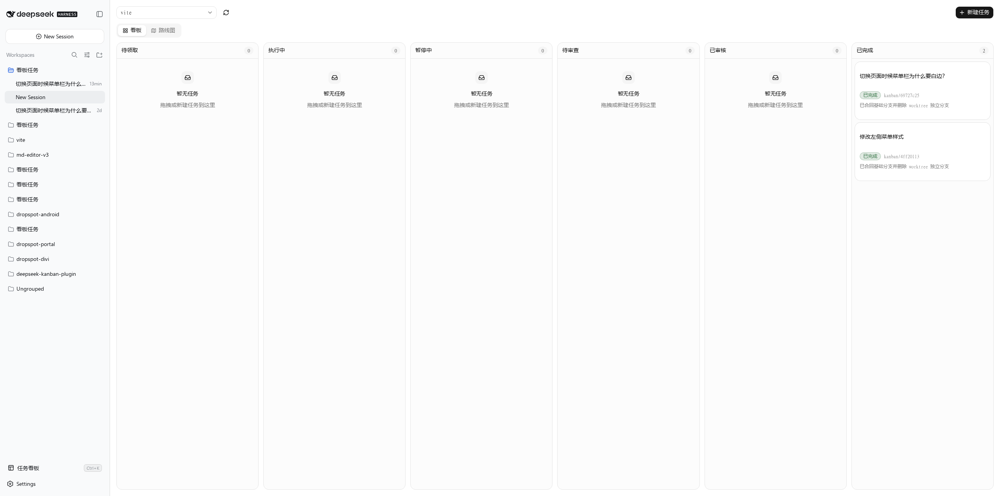
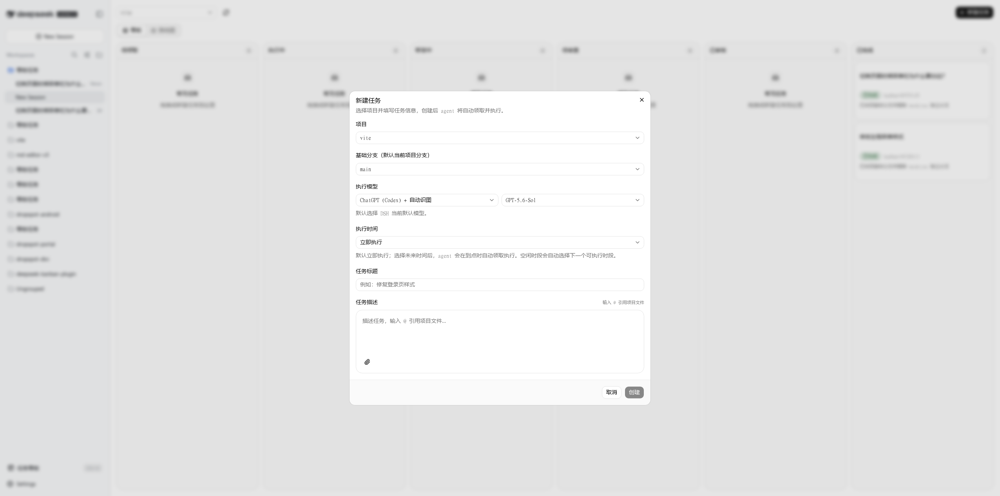

# @deepseek-kanban/plugin

DeepSeek Harness（DSH）任务看板插件 —— 在 DSH Web 左侧边栏提供「任务看板」，把**项目、隔离工作区、AI agent** 串成一条自动化开发流水线：创建任务 → agent 自动领取执行 → 生成变更 → 人工审核 → 自动交付到项目。

## 安装

从 GitHub 直接安装（推荐）：

```bash
dsh plugin --profile desktop add "github:callmesoul/deepseek-kanban-plugin"
```

如需指定版本 / 分支（Tag 或 commit 后跟 `#`）：

```bash
dsh plugin --profile desktop add "github:callmesoul/deepseek-kanban-plugin#main"
```

安装完成后**重启 / 重载 DSH 应用**，侧边栏底部出现「任务看板」入口即安装成功。

> 强制刷新安装：`dsh plugin --profile desktop remove @deepseek-kanban/plugin && dsh plugin --profile desktop add "github:callmesoul/deepseek-kanban-plugin"`

> `dsh` CLI 未在 PATH 上时，可直接用桌面版内置启动器：`"$LOCALAPPDATA/Programs/DeepSeek Harness/resources/runtime/cli/bin/dsh.cmd" plugin --profile desktop add ...`；也可以在 DSH 的「插件市场」里安装。

## 功能特性

- **看板入口**：DSH Web 侧边栏底部「任务看板」按钮，点击打开全屏看板面板（4s 轮询实时刷新，页面不可见时自动暂停轮询）；支持 `Ctrl+K`（macOS 为 `Cmd+K`）快捷键一键打开/关闭。
- **双视图切换**：看板顶部 Tabs 切换「看板」列视图与「路线图」甘特图视图（参考 GitHub Projects Roadmap：左侧任务列表 + 右侧时间轴，按状态分组泳道、周/月刻度自适应、今天竖线、任务条按状态着色，点击任意任务打开详情）。
- **任务状态机**：`待领取 → 执行中 → 待审查 → 已审核 → 已完成`，含 `暂停中` 兜底状态。支持看板列间拖拽手动流转。
- **Agent 输入框**：新建任务描述与任务详情评论统一使用 [agent-textarea](https://github.com/callmesoul/agent-textarea) 的 Agent Composer，支持项目文件引用、任意附件、拖放和剪贴板粘贴；附件以二进制流上传并按内容哈希存储。
- **文件引用**：在输入框中输入 `@` 即弹出当前项目的文件/目录候选，支持 ↑/↓ 选择、Enter/Tab 确认、Esc 关闭；git 项目走 `git ls-files`（尊重 .gitignore），非 git 项目回退目录扫描。
- **agent 自动执行**：任务被 agent 领取后在隔离工作区改码；Git 项目自动提交，非 Git 项目自动生成文件变更集。
- **Agent 默认权限**：看板任务新建的 Agent 会话默认使用 Full access；恢复已有会话时保留会话当前权限设置。
- **git worktree 隔离**：每个任务使用独立 git worktree（`git worktree add`）+ 独立任务分支（`kanban/<id前8>`），从基础分支签出，不影响主工作区。
- **非 Git 快照隔离**：普通目录、无 commit 仓库或 Git CLI 不可用时，自动创建基线副本和 Agent 工作副本；审核前不修改原项目。
- **审核交付**：Git 项目自动 `merge --no-ff`；快照项目在检查相关文件未被外部修改后备份并应用，写入失败自动恢复。
- **单任务单会话**：Agent 会话在首次创建后立即绑定到任务；异常暂停后的恢复、待审查评论续跑和冲突处理都复用该会话，不会静默新建会话；若会话仍在正常执行则继续等待，不重复发送 followup。
- **新建任务配置**：可选执行模型、定时执行时间；Git 项目还可从项目分支中选择基础分支。
- **改动记录**：任务详情记录每次 agent 执行后的改动说明、Git commit 或快照新增/修改/删除统计。
- **定时执行恢复**：设了定时执行的任务，DSH 重启后自动恢复未来定时器；若停机期间错过执行时间，则在下次启动后立即补跑。
- **虚拟任务工作区**：DSH 侧边栏固定显示一个虚拟「看板任务」分组，汇总所有项目的看板 Agent 会话；它不注册真实工作区，也不改变会话实际 `cwd`。
- **一键更新**：GitHub Release 发布新稳定版本时，在 DSH 全局界面提示更新；点击即可安装，systemd 环境会自动重启服务并刷新页面。

## 与其他 DSH 看板插件对比

> 调研快照：2026-09-02。下表以各项目当日 GitHub README 和公开实现为依据；`—` 表示其 README 未将该能力作为功能公开说明，不等同于断言底层绝对无法实现。社区项目迭代很快，选型前请点击仓库链接查看最新文档。

### 代表性项目

| 项目 | 主要定位 | 与本插件的主要差异 |
| --- | --- | --- |
| **本插件** | 面向代码交付的自动化看板 | 创建任务后自动建立 Worktree、运行 Agent、提交改动；人工审核通过后自动合并、清理，冲突可交回同一 Agent 会话处理。 |
| [cloader/dsh-taskboard](https://github.com/cloader/dsh-taskboard) | 人与 Agent 共用的完整任务台账 | Cron、任务模板、DoD 清单、结构化报告、Agent 工具、Diff 和多仓库镜像等管理能力更丰富；Worktree 是可选项且每次执行建立新会话，合并与清理由用户在详情页触发。本插件更强调默认隔离、单任务单会话和审核后的自动收尾。 |
| [FuncWei/dsh-kanban](https://github.com/FuncWei/dsh-kanban) | Hermes 全功能看板移植 | 提供 9 列、多看板、依赖关系、批量操作、诊断、WebSocket 和 SQLite，借助 Python/FastAPI sidecar 与 headless worker 执行。本插件不需要额外 sidecar，重点是与项目 Git 分支直接形成提交—审核—合并闭环。 |
| [scwlkq/dsh-task-board](https://github.com/scwlkq/dsh-task-board) | DSH 原生、可持久化和可审核的任务板 | 支持验收标准、图片、执行轮次、审核/驳回/重试和 Session 历史；本插件进一步内建每任务 Worktree、系统提交、基础分支合并及冲突恢复。 |
| [zhu1090093659/dsh-web / dsh-task-board](https://github.com/zhu1090093659/dsh-web/tree/dev/packages/dsh-task-board) | Host 权威账本与周期任务 | 强项是 Cron、权限确认门、Preset 固定、重启对账及可选防休眠；每次运行创建独立会话。它适合长期调度，本插件更适合一次开发任务持续迭代并最终落到 Git。 |
| [isolat-3k/dsh-kanban](https://github.com/isolat-3k/dsh-kanban) | Hermes 风格 Agent 协作看板 | 提供 9 列、多看板、Agent 管理工具、心跳、进度文件与自动派发；本插件采用 DSH Storage Domain 和原生 Agent Remote，更专注自动提交、人工审核、合并和冲突处理。 |
| [shengsheng90/DSH-taskboard](https://github.com/shengsheng90/DSH-taskboard) | SQLite 项目管理与受控验收 | 提供项目、关系、附件、工作流、CLI、Skill 和 Agent 工具，且只允许人工完成验收；本插件的数据模型更轻，换取开箱即用的 Git Worktree 交付流水线。 |
| [jcc1997/dsh-plugins / kanban](https://github.com/jcc1997/dsh-plugins/tree/main/plugins/kanban) | 可配置 Kanban、门禁和插件化研发流程 | 看板本体支持自定义列、模板、31 个 Agent 工具和可编程门禁；GitHub 分支/MR、Pipeline 与文档审批由配套插件组合。本插件把本地分支隔离、执行、审核和合并收敛在一个插件内，配置更少、流程更固定。 |
| [Ericwong5021/dsh-kanban](https://github.com/Ericwong5021/dsh-kanban) | 现有 DSH Session 的规划与分诊视图 | 卡片本质是 Session，运行/阻塞/完成状态来自实时会话，手工列位置保存在浏览器。本插件拥有独立的 Host 任务状态机，并管理 Session 之外的 Git 生命周期。 |
| [alpacachen/dsh-kanban](https://github.com/alpacachen/dsh-kanban) / [StruggleYang/dsh-project-kanban](https://github.com/StruggleYang/dsh-project-kanban) | 人与 Agent 共同维护的项目规划板 | 强调 Agent 建卡、改卡、自定义列、标签、优先级、搜索等规划体验，不负责自动改码和合并；本插件偏向把已经明确的开发任务直接执行并交付。 |
| [nexsjournal/dsh-tryboard-plugin](https://github.com/nexsjournal/dsh-tryboard-plugin) | DSH 内的手工 Trello 看板 | 支持多看板、自定义列和同列排序，数据存入 DSH 设置，但不驱动 Agent。本插件列结构固定，由状态机保障执行与审核语义。 |

另外还发现了若干侧重点相邻的实现：[ANITOCE/dsh-task-board](https://github.com/ANITOCE/dsh-task-board)（浏览器端 Cron 与真实 Session 执行）、[raosay/dsh-kanban](https://github.com/raosay/dsh-kanban)（精简看板与逐任务模型选择）、[maochiy/dsh-taskboard-plugin](https://github.com/maochiy/dsh-taskboard-plugin)（通用任务字段、Session 关联与 Agent 工具）以及 [SLin-code/dsh-task-notice-board](https://github.com/SLin-code/dsh-task-notice-board)（Workspace → Task → Session 层级和跨 Session 任务记忆）。它们分别更偏向轻量调度、通用任务管理或多会话协作，并非与本插件完全相同的 Git 交付流程。

### 核心能力矩阵

| 能力 | 本插件 | cloader | FuncWei | scwlkq | dsh-web | Ericwong | tryboard |
| --- | :---: | :---: | :---: | :---: | :---: | :---: | :---: |
| Host 侧权威持久化 | ✅ Storage Domain | ✅ JSON 台账 | ✅ SQLite | ✅ DSH Storage | ✅ JSON 账本 | △ Session 为主，列位置在浏览器 | △ DSH Settings |
| 创建任务后由真实 Agent 执行 | ✅ 自动领取 | ✅ 手动/定时/Agent 认领 | ✅ headless worker | ✅ | ✅ | ✅ | — |
| 每任务独立 Git Worktree | ✅ 默认且必经 | △ 可选、每次执行 | — | — | — | — | — |
| 系统统一提交 Agent 改动 | ✅ | — | — | — | — | — | — |
| 人审后自动合并并清理 | ✅ | △ 手动一键操作 | — | — | — | — | — |
| 合并冲突交回原 Agent 解决 | ✅ | — | — | — | — | — | — |
| 后续评论复用同一 Agent 会话 | ✅ | △ 新执行会话读取交接 | — | ✅ | — | ✅ 卡片即会话 | — |
| `@` 项目文件引用 + 任意文件上传 | ✅ | — | — | △ 图片 | — | — | — |
| Host 端定时执行 | ✅ 单次时间 | ✅ Cron | ✅ Scheduled 流程 | — | ✅ Cron | — | — |
| 看板 + Roadmap 甘特图 | ✅ | — | — | — | — | — | — |
| 应用内检查 Release 并一键更新 | ✅ | — | — | — | — | — | — |
| 不依赖额外 sidecar / 数据库 | ✅ | ✅ | — | ✅ | ✅ | ✅ | ✅ |

### 本插件的优势

1. **从任务到代码落地主路径最短**：它不是只给任务或 Session 分栏，而是默认执行 `创建 → Worktree 隔离 → Agent 改码 → 系统提交 → 人工审核 → 自动合并与清理`，无需再拼接 Git 或 Pipeline 插件。
2. **隔离不是可选约定，而是状态机的一部分**：每个 Git 任务始终从选定基础分支创建独立任务分支和 Worktree；Agent 不操作分支，提交、合并和清理由主机端统一完成。
3. **审核通过即可完成交付**：基础分支正被主工作区使用时通过 `--autostash` 合并；未被签出时使用临时 Worktree 合并并原子更新引用。冲突会安全回滚、记录文件，再由原 Agent 解决，主仓库不会停在半合并状态。
4. **任务上下文连续**：首次执行即绑定唯一 Agent 会话；暂停恢复、审核意见、追加附件和冲突处理都向该会话追加 followup，避免多轮修改散落在不同会话中。
5. **输入材料可直接被 Agent 使用**：`@` 搜索遵循项目 Git 文件边界；图片以原生内容块发送，普通文件以二进制流进入 SHA-256 内容寻址存储，并挂载到任务 Worktree，适合带设计稿、日志、压缩包或文档下达任务。
6. **交付过程更容易审阅**：看板与 Roadmap 双视图同时覆盖状态和时间；详情页统一展示任务描述、Agent 输出、评论、附件、改动摘要和 commit hash。
7. **维护链路内置**：稳定 GitHub Release 出现后可在 DSH 内完成版本校验、安装和状态恢复；本地 `file:` / `link:` 安装会自动禁用更新，避免覆盖开发源码。

### 什么时候更适合选择其他项目

- 需要**自定义列、多看板、父子依赖、批量操作或复杂任务字段**：优先考察 FuncWei、shengsheng90、nexsjournal 或 alpacachen 的实现。
- 需要**重复 Cron、模板、验收清单、Agent 自助认领、结构化报告或多仓库镜像**：`cloader/dsh-taskboard` 的任务管理面更完整。
- 需要**自定义门禁、GitHub MR、可编排 Pipeline 和多插件组合**：`jcc1997/dsh-plugins` 更灵活。
- 需要**一个任务承载多个 Session，并在 Session 间沉淀受控长期记忆**：`SLin-code/dsh-task-notice-board` 更贴合该模型。
- 只想整理现有 Session 或手工规划，不希望插件自动改动仓库：Ericwong、nexsjournal、alpacachen 或 StruggleYang 的方案更轻量。

## 架构概览

DSH 是「主机平面 cordis 插件 + 客户端插件」双层架构，本插件对应两个部分：

```
┌───────────────────────────── DSH Web（浏览器） ─────────────────────────────┐
│  lib/client.js（React 外壳）                                                  │
│    ├─ sidebar.footer.action  → 侧边栏「任务看板」入口                          │
│    └─ shell.overlay          → 全屏看板面板，挂载 Vue 应用                     │
│         └─ src/（Vue 3 + Tailwind v4 + shadcn-vue 看板 UI）                    │
│               └─ ctx.remote.kanban.*（Typert Remote 远程调用）                │
└───────────────────────────────────┬───────────────────────────────────────────┘
                                    │
┌───────────────────────────────────▼───────────────────────────────────────────┐
│  lib/index.js（主机平面 cordis 插件）                                            │
│  KanbanService extends TypertRemoteService（注册为 ctx.kanban）                  │
│    ├─ 数据：ctx.storageDomain 的 kanban 域（tasks 表）→ ~/.dsh/storages        │
│    ├─ 附件：ctx.webServer 二进制路由 → ~/.dsh/attachments/kanban              │
│    ├─ 项目：ctx.workspaceRegistry.list()（与 DSH 工作区绑定）                   │
│    ├─ git：child_process 执行（主机平面，不受沙箱限制）                          │
│    ├─ agent：ctx.agents.create + followup + whenIdle                           │
│    └─ 更新：GitHub Release 检查 → 独立 updater 安装 → 重启 dsh-web              │
└────────────────────────────────────────────────────────────────────────────────┘
```

- **主机端**（`lib/index.js`）：状态机、Git/快照工作区调度、agent 执行、数据持久化。
- **客户端**（`src/client.ts` + `src/` 看板 UI）：入口注册、看板展示与交互。
- 客户端经 `ctx.remote.kanban.<method>` 调用主机远程方法；附件上传和读取直接使用同源 HTTP 二进制路由。看板打开期间约 4s 轮询 `getBoard()`，页面不可见时暂停轮询。

## 目录结构

```
.
├── lib/                      # 构建产物（也是插件包体）
│   ├── index.js              # 主机端服务（KanbanService，手写源文件）
│   ├── client.js             # 客户端 bundle（构建生成，ModuleLoader 包装）
│   ├── update.js             # 版本比较、安装来源识别和更新状态持久化
│   ├── updater.js            # 独立更新进程（安装、校验版本、重启服务）
│   └── client.raw.js         # vite 中间产物（被 wrap-client 包装）
├── scripts/
│   ├── wrap-client.mjs       # 把 vite CJS 产物包装成 DSH ModuleLoader 格式
│   ├── smoke-host.mjs        # 主机端冒烟测试（内存态跑完整任务流转）
│   ├── test-update.mjs       # 更新器单元测试（版本比较、安装来源、profile 探测）
│   ├── sync-dsh.mjs          # 安装到 DSH profile（跨平台；Windows 下自动中转 UNC 路径）
│   └── deploy-local.sh       # 本地部署薄包装（build → sync-dsh.mjs）
├── src/                      # 客户端源码（Vue 3 + shadcn-vue）
│   ├── client.ts             # React 外壳：挂载 Remote、注册侧边栏入口与 overlay
│   ├── kanban-entry.ts       # Vue 应用挂载/卸载
│   ├── remote.ts             # Typert Remote 描述符（远程方法声明）
│   ├── App.vue               # 看板根组件
│   ├── assets/index.css      # 全局样式（含 .markdown-body 排版）
│   ├── components/           # 看板、任务详情、新建任务等 Vue 业务组件
│   │   ├── agent-composer/   # Agent 输入框、附件预览与提交数据格式化
│   │   └── ui/               # shadcn-vue 基础组件
│   ├── composables/useBoard.ts
│   └── lib/                  # Remote bridge、类型、Markdown 渲染、项目文件适配
├── docs/                     # 设计文档 + 截图
└── package.json
```

## 快速开始

### 环境要求

- Node.js ≥ 22.12（pnpm 管理依赖）
- DSH ≥ 0.2.0（桌面版内置 `desktop` profile；本插件兼容 0.1.7-rc.1 ~ 0.2.x）
- 项目基于 WSL（Ubuntu），以下命令在 WSL 内执行

### 安装依赖

```bash
cd /home/callmesoul/code/deepseek-kanban-plugin
pnpm install
```

### 构建

```bash
pnpm build        # vite build + wrap-client.mjs，生成 lib/client.js
pnpm watch        # 开发时增量构建
```

### 安装到 DSH

**普通用户 / 快速体验（从 GitHub 安装）：**

```bash
dsh plugin --profile desktop add "github:callmesoul/deepseek-kanban-plugin"
```

**本地开发（`file:` 协议，硬链接实时生效）：**

```bash
# 方式一：直接安装（推荐）
dsh plugin --profile desktop add "file:$(pwd)"

# 方式二：完整重建 + 重装
pnpm sync:dsh     # build + 自动中转 + remove + add（跨 Windows/WSL 均可用）
```

> ℹ️ Windows 版 pnpm 无法直接从 `\\wsl.localhost\...` 这类 UNC 路径安装 `file:` 依赖。`pnpm sync:dsh` 会自动把产物复制到本地中转目录（`%LOCALAPPDATA%\dsh-kanban-plugin-stage`）再安装，无需手工处理；如手动执行 `dsh plugin add`，请先把仓库产物复制到本地盘。

安装后**重启 / 重载 DSH 应用**（或重载插件）生效。之后侧边栏底部出现「任务看板」入口。

### 测试

```bash
pnpm test         # 主机任务流 + 插件更新测试
pnpm test:smoke   # 内存态验证 创建→评论继续→审核→合并 全流程
pnpm test:update  # 验证版本、来源、状态和安装命令安全约束
```

## 使用说明



### 插件更新

插件启动后会检查仓库的 GitHub Latest Release。发现高于当前版本的稳定 Release 时，DSH 右上角会显示更新提示，可查看发布详情或点击「立即更新」。

- 通过 `github:callmesoul/deepseek-kanban-plugin` 安装的插件支持一键更新。
- 更新器只安装提示中经过主机端校验的最新稳定 Tag，不执行浏览器传入的任意命令。
- 使用 `file:`、`link:` 的本地开发安装不会检查或覆盖源码。
- Linux（systemd）下 `dsh-<profile>.service` 正在运行时，安装完成后自动重启服务；桌面版等不带 systemd 的宿主会提示手动重启 DSH。
- 更新状态保存在 `~/.dsh/updates/deepseek-kanban.json`，安装或重启失败时会在提示中显示错误。

### 新建任务

1. 点击看板「新建任务」。
2. 选择**项目**（来自 DSH 工作区）。正常 Git 仓库会加载基础分支；非 Git 目录、无 commit 仓库或 Git CLI 不可用时自动使用隔离文件快照。
3. 填写标题与描述，可选选择**执行模型**与**执行时间**（留空立即执行，未来时间到点由主机端定时器自动领取）。
4. 创建后任务进入「待领取」，agent 自动领取执行。



### 任务描述与评论

任务描述和待审查任务的评论框使用同一套 Agent Composer：

- 输入 `@` 可搜索并引用当前项目中的文件或目录；使用 ↑/↓ 切换候选，Enter/Tab 确认，Esc 关闭。
- 可通过附件按钮、拖放或剪贴板粘贴添加图片、文档、压缩包、音视频等任意文件，并在提交前预览或移除。单文件上限 50 MiB，每条消息附件总量上限 100 MiB、最多 10 个。
- 附件通过原始二进制请求上传到 SHA-256 内容寻址存储，任务记录只保存引用。图片还会由 DSH 图片服务校验并以原生图片内容块发送给 Agent；其他文件会复制到任务隔离工作区的 `.kanban-attachments` 目录供 Agent 读取，不进入 Git 提交或快照变更集。
- 详情页通过受任务归属校验的同源 URL 懒加载图片或下载文件，支持浏览器缓存和 Range 请求，不再通过 JSON RPC 返回 Base64。
- 任务描述中 Enter 用于换行；评论框中 Enter 提交，Shift+Enter 换行。中文输入法组合输入期间不会误提交。
- 文本仍按 Markdown 保存并在任务详情中安全渲染，但输入区域不提供实时预览或 Markdown 语法提示。
- 项目目录由当前项目或任务上下文自动提供，输入框内不重复显示。

### 状态流转

```
待领取(todo) ──自动领取──▶ 执行中(running) ──生成变更──▶ 待审查(review)
     ▲                         │                              │
     │                         │ 执行失败                     │ 审核通过
     │                         ▼                              ▼
     └──────继续执行────── 暂停中(paused) ◀──交付失败── 已审核(approved)
                              ▲                              │
                              └────────并发冲突──────────────┘
                                                             │ 自动交付
                                                             ▼
                                                          已完成(done)
```

- **待领取（todo）**：新建任务默认状态，agent 自动领取后进入执行中。
- **执行中（running）**：agent 在 Git Worktree 或文件快照工作副本中改码，完成后生成 Git commit 或文件变更集。
- **暂停中（paused）**：兜底状态。Agent、工作区、提交、合并、快照应用或并发冲突失败时进入；恢复时继续使用同一个 Agent 会话。
- **待审查（review）**：等待人工审核，可查看改动记录与快照文件统计；也可评论让 agent 在同一隔离工作区继续修改。
- **已审核（approved）**：正在把任务变更交付到基础分支或原项目目录。
- **已完成（done）**：Git 分支已合并或快照文件已安全应用，任务隔离工作区已清理。
- **手动流转**：看板列间拖拽可手动移动任务状态；拖到 `执行中` 会触发 agent 执行，拖到 `已审核` 会触发交付。

### git 流程

- **新建任务**：记录 `baseBranch`（基础分支）与 `taskBranch`（`kanban/<id前8>`）。
- **执行**：`git worktree add -b <taskBranch> <path> <baseBranch>` 创建独立 worktree → agent 在 worktree 中改码 → `git add -A && git commit`。使用 worktree 而非 checkout，主工作区分支不受影响。
- **审核通过**：若主工作区当前在基础分支上 → `git merge --no-ff --autostash <taskBranch>`；否则创建临时 worktree 合并后 `update-ref` 更新目标分支。合并失败会捕获冲突文件并执行 `git merge --abort`，不会把主仓库留在半合并状态。
- **冲突恢复**：在任务 worktree 中把最新基础分支合入任务分支 → 原 Agent 解决冲突 → 系统检查残留冲突标记和未合并索引 → 提交冲突解决结果 → 回到待审查。再次审核通过后才合回基础分支并清理 worktree/任务分支。
- **评论继续**：复用已有 worktree 和同一个 Agent 会话，追加 followup 继续改码后重新提交；若原会话无法恢复，任务暂停并保留错误，不创建替代会话。

### 非 Git 快照流程

- **模式选择**：非 Git 目录、没有 commit 的仓库以及 Git CLI 不可用的项目自动选择 `snapshot`，不会修改项目或静默执行 `git init`。
- **隔离执行**：在 `$DSH_HOME/kanban/snapshot-workspaces/<taskId>` 下创建只读语义的基线副本与 Agent 工作副本；`.git`、依赖目录、构建产物和 `.kanban-attachments` 不进入变更集。
- **变更检测**：以 SHA-256、文件类型和权限比较基线与工作副本，记录新增、修改、删除文件；单任务最多 100000 个文件、5 GiB。
- **安全应用**：审核时仅检查任务涉及的路径。若原项目对应文件已变化则停止应用并列出冲突；Agent 可参考基线、当前项目和任务版本在隔离副本中重新处理。
- **恢复保护**：应用前备份全部受影响文件并写入 journal；写入失败或服务中途重启时自动恢复。成功备份保留 7 天，任务工作副本随即清理。

## 远程 API（ctx.remote.kanban.*）

| 方法 | 说明 |
| --- | --- |
| `getPluginUpdateInfo()` | 获取当前版本、安装来源、最新 Release 与更新状态 |
| `startPluginUpdate({ input: { tag } })` | 安装经过校验的最新稳定 Release |
| `acknowledgePluginUpdate({ input: { targetVersion } })` | 确认并清理已完成/失败的更新状态 |
| `listProjects()` | 列出 DSH 工作区（项目）列表 |
| `getBoard()` | 获取看板全量数据（项目 + 任务 + 状态） |
| `getTaskImage({ input: { taskId, attachmentId } })` | 兼容旧客户端读取图片（新客户端使用二进制 HTTP 路由） |
| `listCreateTaskOptions()` | 新建任务选项（模型分组 + 默认模型） |
| `listBranches({ input: { projectId } })` | 获取项目 git 分支列表（含当前分支） |
| `listProjectPaths({ input: { projectId } })` | 获取项目文件/目录树（供 `@` 文件引用使用） |
| `createTask({ input: { ..., attachments? } })` | 新建任务 |
| `moveTask({ input: { taskId, to } })` | 移动任务状态（拖拽 / 手动流转） |
| `approveTask({ input: { taskId } })` | 审核通过（触发合并） |
| `resumeTask({ input: { taskId } })` | 恢复暂停的任务 |
| `commentTask({ input: { taskId, comment, attachments? } })` | 评论并继续（恢复 agent 会话追加 followup） |
| `deleteTask({ input: { taskId } })` | 删除任务 |

调用均返回 `{ ok: true, value } | { ok: false, error }`（见 `src/lib/types.ts`）。

附件 HTTP 路由：`POST /kanban/attachments` 接收原始二进制请求体，`GET|HEAD /kanban/attachments/:attachmentId?taskId=:taskId` 在校验任务归属后返回文件内容。

## 开发指南

### 新增一个远程方法

1. `lib/index.js`：在 `KanbanService` 添加方法，并加入 `markRemoteMethods` 注册列表。
2. `src/remote.ts`：添加对应 descriptor（参数名须与主机方法参数名一致）。
3. `src/lib/bridge.ts`：在 `KanbanApi` 接口补充签名。
4. 重新 `pnpm build` 生成 client.js，重载 DSH 生效。

### 构建与安装注意

- `lib/index.js` 为手写源文件，`lib/client.js` 为构建产物（勿手改）。
- 通过 pnpm `file:` 协议安装后，profile 副本与项目源文件是**硬链接**：`pnpm build` 后源文件即生效，无需手动拷贝；但改 `package.json` 的 `files` 字段或需要彻底重装时，用 `pnpm sync:dsh`。
- **发布/安装注意**：`package.json` 的 `files` 字段必须包含 `cordis.patch.yml`（`dsh.bundle.patch` 依赖它），否则 GitHub 安装后 DSH 启动会因找不到 overlay 报错；profile 的 `cordis.patch.yml` 中不要再重复 insert `kanban`，否则报 `duplicate loader entry id`。
- 改 host 端或客户端代码后，都需要**重载 DSH 应用/插件**才生效。
- 自动更新以 GitHub Release 为唯一稳定通道；发布时需要同步更新版本号、`CHANGELOG.md`、Git Tag 和 GitHub Release。

## 常见问题

**Q：「看板任务」为什么能汇总不同项目的会话？**
它是插件在侧边栏提供的虚拟分组，会根据任务记录中的 Agent 会话 ID 汇总展示，不是绑定单一 `cwd` 的真实 DSH 工作区。插件启动时会迁移会话并清理旧版创建的「`{project}看板任务`」工作区。

**Q：任务详情里改动记录为空？**
改动记录自「记录 agent 最终输出」版本起生效。历史已完成任务是在旧版本执行的，无法回溯补录；新任务执行后即有记录。

**Q：为什么改了源码不生效？**
确保已执行 `pnpm build` 且已重载 DSH 应用。若仍未生效，可 `pnpm sync:dsh` 重装。

## 变更记录

详见 [CHANGELOG.md](./CHANGELOG.md)。

## License

MIT
